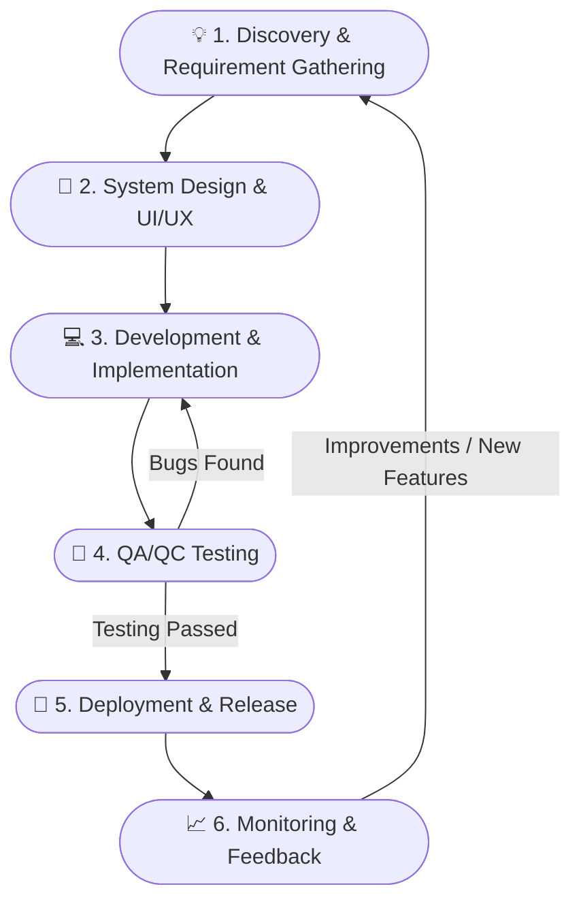
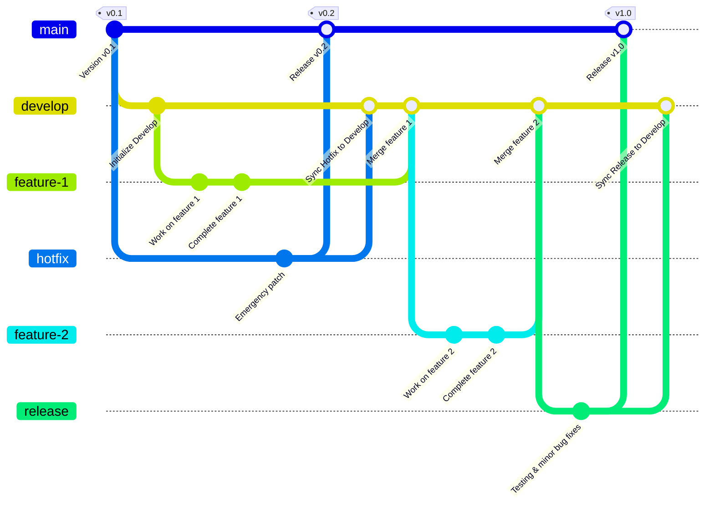
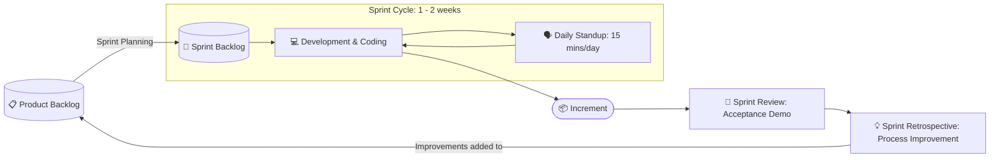

# Professional Software Product Development Process

## 1. End-to-End Workflow Overview

---

## 2. Detailed Phases

### Phase 1: Discovery & Requirements

- **Objective**: Identify the business problem, actual user needs, and product feasibility.
- **Key Activities:**
  - Conduct market research and competitor analysis.
  - Interview users, survey needs (User Research).
  - Write product requirements: PRD (Product Requirement Document), User Stories, and Acceptance Criteria (AC).
- **Deliverables:** PRD, Product Backlog, User Stories list.

---

### Phase 2: System Design & UI/UX (Design Phase)

- **Objective:** Shape the user experience interface and build a solid technical foundation.
- **Key Activities:**
  - **UI/UX Design:** Create wireframes, User Flows, detailed design prototypes on Figma/Adobe XD, and Design System.
  - **System Architecture:** Design software architecture (Monolith/Microservices), database schema (ERD), and API specifications (OpenAPI/Swagger).
- **Deliverables:** Figma Prototype, ERD Diagram, API Specification docs.

---

### Phase 3: Development & Implementation

- **Objective:** Transform designs and requirements into actual source code.
- **Key Activities:**
  - Break work down into Sprints (usually 1 - 2 weeks following Scrum standards).
  - Develop Frontend (Web/Mobile) and Backend (APIs, Database logic).
  - Organize regular code reviews and write Unit Tests to ensure code quality.
  - Apply Git Workflow rules.
- **Deliverables:** Complete source code with Unit Tests, merged into the development branch.

---

### Phase 4: Testing & Quality Assurance (QA/QC)

- **Objective:** Ensure the product functions according to requirements, with no critical functional or security bugs.
- **Key Activities:**
  - Write Test Plans and Test Cases.
  - Conduct various testing types:
    - **Functional Testing:** Verify business features.
    - **Integration & Regression Testing:** Ensure compatibility between modules and that new code doesn't break existing functionality.
    - **Performance & Security Testing:** Evaluate load capacity and information security.
  - Conduct UAT (User Acceptance Testing).
- **Deliverables:** Test Report, Bug Tracker tickets.

---

### Phase 5: Deployment & Release

- **Objective:** Release the product to the live environment for end-users.
- **Key Activities:**
  - Automate packaging and testing via CI/CD pipelines (GitHub Actions, GitLab CI, Jenkins).
  - Deploy sequentially across environments:
    - `Development` $\rightarrow$ `Staging / UAT` $\rightarrow$ `Production`.
  - Apply safe deployment strategies: Blue-Green Deployment or Canary Release (gradual release to a small group of users).
- **Deliverables:** Official release (Production Build, App Store / Google Play / Web Server).

---

### Phase 6: Monitoring, Maintenance & Feedback

- **Objective:** Ensure 24/7 system stability and collect data for continuous improvement.
- **Key Activities:**
  - Monitor the system and log errors in real-time (Sentry, Prometheus, Grafana, Datadog).
  - Track user behavior data (Google Analytics, Mixpanel, Hotjar).
  - Fix urgent issues (Hotfixes).
  - Hold a Sprint Retrospective to improve team workflows.
- **Deliverables:** System Uptime Report, a list of feature improvements for the next Backlog.

---

## 3. Gitflow Workflow

### Branching Diagram

---

### Branch Roles and Rules Explanation

The standard Gitflow model consists of 2 long-lived main branches (master, develop) and 3 supporting branch groups (hotfix, feature, release):

1. **`master` branch (or `main` - Production branch):**
   - **Purpose:** Stores thoroughly tested source code that is running directly in the live environment (Production).
   - **Versioning (Git Tag):** Every code update to `master` is tagged with a corresponding release version (`v0.1`, `v0.2`, `v1.0`).
   - **Rule:** Strictly no direct coding or commits to `master`. This branch only receives code via merges from `hotfix` or `release`.

2. **`develop` branch (Central development branch):**
   - **Purpose:** The main integration branch for the development team, containing the latest features prepared for the next release.
   - **Rule:** Branched off from `master` from the beginning. It serves as the root branch to spawn `feature` branches and receives merge results from `feature`, `hotfix`, and `release` to keep the source code synchronized.

3. **`hotfix` branch (Emergency fixes on Production):**
   - **Purpose:** Resolves critical issues arising directly in the live version (e.g., `v0.1`) without waiting for the next scheduled release.
   - **Flow:**
     - Branches directly from `master` at the point where the `v0.1` version encounters an error.
     - After the fix is complete, merges back into `master` and is tagged with the patch version `v0.2`.
     - **Mandatory:** Must be merged and synchronized immediately down to the `develop` branch to prevent the old bug from reappearing in future updates.

4. **`feature` branch (New feature development):**
   - **Purpose:** Used by developers to build individual modules or specific features (`feature-1`, `feature-2`).
   - **Flow:**
     - Branches off from `develop`.
     - Developers commit their internal processing steps on their own branch.
     - Once the feature is complete, it is merged back into `develop`, and the feature branch is deleted to keep the repository clean.

5. **`release` branch (Packaging and pre-release testing):**
   - **Purpose:** Prepares for a major version launch (`v1.0`). In this phase, adding new features stops; the focus shifts entirely to testing (QA/QC), configuration cleanup, and minor bug fixing.
   - **Flow:**
     - Branches off from `develop` when the necessary features for the release are ready.
     - Testing is conducted and final commits are finalized.
     - Merges into `master` to tag the official release (`v1.0`).
     - Merges back into `develop` to bring any fixes/adjustments made during the release phase into the development branch.

---

## 4. Agile/Scrum Development Process

Agile is a flexible software development philosophy that adapts quickly to change; within this, **Scrum** is the most popular implementation framework, organizing work into iterative cycles called **Sprints** (typically lasting 1 to 2 weeks).

---

### Scrum Lifecycle Diagram

---

### 1. Three Core Scrum Roles

- **Product Owner (PO):** Represents the customer and users. Responsible for shaping the product vision and prioritizing items in the Product Backlog to maximize business value.
- **Scrum Master (SM):** The facilitator and guide who protects the team from external interruptions, removes impediments, and ensures all members properly adhere to Scrum rules.
- **Development Team (Dev, QA, UI/UX):** A cross-functional, self-organizing group that directly designs, codes, and tests to transform requirements into complete features.

---

### 2. Three Key Scrum Artifacts

- **Product Backlog:** A comprehensive list of all features, requirements, enhancements, and bug fixes needed for the product (prioritized by the PO).
- **Sprint Backlog:** A set of User Stories selected from the Product Backlog during Sprint Planning that the team commits to completing within a single Sprint.
- **Increment:** The completed portion of the product that has met the **Definition of Done (DoD)**, is fully functional, and is ready to be delivered to users.

---

### 3. Four Standard Events in a Sprint Cycle (Scrum Events)

1. **Sprint Planning:**
   - **Objective:** The PO explains the priority features; the entire team discusses, estimates the workload (Story Points), and selects User Stories to pull into the Sprint Backlog.
2. **Daily Standup:**
   - **Duration:** Strictly limited to a maximum of 15 minutes at the beginning of each workday.
   - **Objective:** Each member briefly answers 3 questions:
     - _What did I do yesterday?_
     - _What will I do today?_
     - _Am I facing any impediments or blockers?_
3. **Sprint Review:**
   - **Objective:** Takes place at the end of the Sprint. The team provides a live demo of the completed features to the PO and Stakeholders to gather real-world feedback.
4. **Sprint Retrospective:**
   - **Objective:** Takes place immediately after the Review. The team reflects internally:
     - _What went well?_
     - _What didn't go well and needs fixing?_
     - _What specific action items need to be improved in the next Sprint?_
