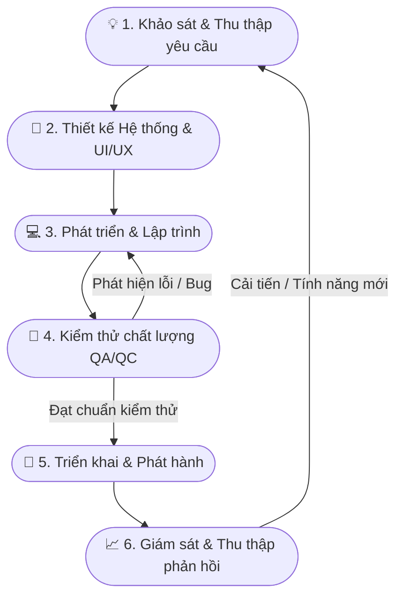
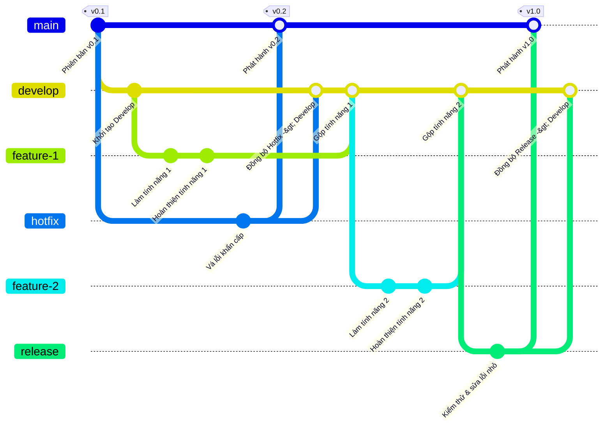
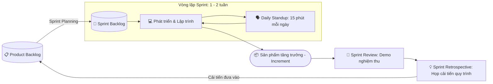

# Quy Trình Phát Triển Sản Phẩm Phần Mềm Chuyên Nghiệp

Tài liệu này tổng hợp các giai đoạn chuẩn trong quy trình phát triển sản phẩm phần mềm (Software Product Development Life Cycle - SDLC), áp dụng theo mô hình Agile/Scrum hiện đại.

---

## 1. Sơ đồ tổng quan quy trình (End-to-End Workflow)

---

## 2. Chi tiết từng giai đoạn

### Giai đoạn 1: Khám phá & Thu thập yêu cầu (Discovery & Requirements)

- **Mục tiêu:** Xác định bài toán kinh doanh, nhu cầu thực tế của người dùng và tính khả thi của sản phẩm.
- **Các hoạt động chính:**
  - Nghiên cứu thị trường và phân tích đối thủ cạnh tranh.
  - Phỏng vấn người dùng, khảo sát nhu cầu (User Research).
  - Viết tài liệu yêu cầu sản phẩm: **PRD** (Product Requirement Document), **User Stories**, tiêu chí chấp nhận (**Acceptance Criteria - AC**).
- **Bàn giao (Deliverables):** Tài liệu PRD, Product Backlog, danh sách User Stories.

---

### Giai đoạn 2: Thiết kế hệ thống & UI/UX (Design Phase)

- **Mục tiêu:** Định hình giao diện trải nghiệm người dùng và xây dựng bộ khung kỹ thuật vững chắc.
- **Các hoạt động chính:**
  - **UI/UX Design:** Vẽ wireframe, luồng người dùng (User Flow), bản mẫu thiết kế chi tiết trên Figma/Adobe XD và Design System.
  - **System Architecture:** Thiết kế kiến trúc phần mềm (Monolith/Microservices), cơ sở dữ liệu (ERD), đặc tả API (OpenAPI/Swagger).
- **Bàn giao (Deliverables):** Figma Prototype, ERD Diagram, API Specification docs.

---

### Giai đoạn 3: Phát triển & Lập trình (Development / Implementation)

- **Mục tiêu:** Chuyển hóa bản thiết kế và yêu cầu thành mã nguồn thực tế.
- **Các hoạt động chính:**
  - Chia nhỏ công việc thành các **Sprints** (thường từ 1 - 2 tuần theo chuẩn Scrum).
  - Lập trình Frontend (Web/Mobile) và Backend (APIs, Database logic).
  - Tổ chức code reviews định kỳ, viết **Unit Test** để đảm bảo chất lượng code.
  - Áp dụng quy tắc Git Workflow.
- **Bàn giao (Deliverables):** Mã nguồn hoàn chỉnh kèm Unit Test, merge vào branch phát triển.

---

### Giai đoạn 4: Kiểm thử & Đảm bảo chất lượng (Testing & QA/QC)

- **Mục tiêu:** Đảm bảo sản phẩm hoạt động đúng yêu cầu, không có lỗi nghiêm trọng về chức năng và bảo mật.
- **Các hoạt động chính:**
  - Viết tài liệu **Test Plan** và **Test Cases**.
  - Tiến hành kiểm thử đa dạng:
    - **Functional Testing:** Kiểm tra tính năng nghiệp vụ.
    - **Integration & Regression Testing:** Kiểm tra độ tương thích giữa các module và đảm bảo code mới không làm hỏng code cũ.
    - **Performance & Security Testing:** Đánh giá hiệu năng chịu tải và an toàn thông tin.
  - Kiểm thử chấp nhận người dùng (**UAT - User Acceptance Testing**).
- **Bàn giao (Deliverables):** Báo cáo kết quả kiểm thử (Test Report), Bug Tracker ticket.

---

### Giai đoạn 5: Triển khai & Phát hành (Deployment & Release)

- **Mục tiêu:** Đưa sản phẩm lên môi trường thực tế để người dùng cuối sử dụng.
- **Các hoạt động chính:**
  - Tự động hóa việc đóng gói và kiểm tra qua quy trình **CI/CD** (GitHub Actions, GitLab CI, Jenkins).
  - Triển khai tuần tự qua các môi trường:
    - `Development` $\rightarrow$ `Staging / UAT` $\rightarrow$ `Production`.
  - Áp dụng chiến lược triển khai an toàn: **Blue-Green Deployment** hoặc **Canary Release** (phát hành dần cho một nhóm nhỏ người dùng).
- **Bàn giao (Deliverables):** Bản phát hành chính thức (Production Build, App Store / Google Play / Web Server).

---

### Giai đoạn 6: Giám sát, Bảo trì & Thu thập phản hồi (Monitoring & Maintenance)

- **Mục tiêu:** Đảm bảo hệ thống vận hành ổn định 24/7 và thu thập dữ liệu để cải tiến liên tục.
- **Các hoạt động chính:**
  - Giám sát hệ thống và log lỗi theo thời gian thực (Sentry, Prometheus, Grafana, Datadog).
  - Thu thập dữ liệu hành vi người dùng (Google Analytics, Mixpanel, Hotjar).
  - Sửa lỗi phát sinh khẩn cấp (Hotfixes).
  - Họp hồi tưởng (**Sprint Retrospective**) để cải tiến quy trình làm việc trong nhóm.
- **Bàn giao (Deliverables):** Báo cáo độ ổn định (System Uptime Report), danh sách tính năng cải tiến cho Backlog tiếp theo.

---

## 3. Quy trình phối hợp Git (Gitflow Workflow)

### Sơ đồ luồng nhánh (Branching Diagram)

---

### Giải thích vai trò các nhánh và quy tắc làm việc

Mô hình Gitflow chuẩn gồm 2 nhánh chính lâu dài (`master`, `develop`) và 3 nhóm nhánh phụ trợ (`hotfix`, `feature`, `release`)[cite: 1]:

1. **Nhánh `master` (hoặc `main` - Nhánh Production):**
   - **Mục đích:** Lưu trữ mã nguồn đã được kiểm thử kỹ lưỡng và đang chạy trực tiếp trên môi trường thực tế (Production)[cite: 1].
   - **Đánh dấu phiên bản (Git Tag):** Mỗi lần cập nhật code lên `master` đều được gắn một Tag tương ứng với phiên bản phát hành (`v0.1`, `v0.2`, `v1.0`)[cite: 1].
   - **Quy tắc:** Tuyệt đối không lập trình hay commit trực tiếp vào `master`[cite: 1]. Nhánh này chỉ nhận code thông qua thao tác merge từ `hotfix` hoặc `release`[cite: 1].

2. **Nhánh `develop` (Nhánh phát triển trung tâm):**
   - **Mục đích:** Là nhánh tích hợp mã nguồn chính của nhóm phát triển, chứa các tính năng mới nhất chuẩn bị cho phiên bản tiếp theo[cite: 1].
   - **Quy tắc:** Tách ra từ `master` ngay từ đầu[cite: 1]. Đóng vai trò là nhánh gốc để sinh ra các nhánh `feature` và tiếp nhận kết quả merge từ `feature`, `hotfix`, `release` để mã nguồn luôn đồng bộ[cite: 1].

3. **Nhánh `hotfix` (Sửa lỗi khẩn cấp trên Production):**
   - **Mục đích:** Xử lý các sự cố nghiêm trọng phát sinh trực tiếp ở bản `v0.1` trên môi trường thực tế mà không thể chờ đợt phát hành định kỳ[cite: 1].
   - **Luồng đi:**
     - Tách trực tiếp từ `master` tại thời điểm bản `v0.1` gặp lỗi[cite: 1].
     - Sau khi vá lỗi xong, merge ngược lại vào `master` và gắn nhãn phiên bản vá lỗi `v0.2`[cite: 1].
     - **Bắt buộc:** Phải merge đồng bộ ngay xuống nhánh `develop` để tránh việc lỗi cũ bị xuất hiện lại ở các bản cập nhật sau[cite: 1].

4. **Nhánh `feature` (Phát triển tính năng mới):**
   - **Mục đích:** Dành cho lập trình viên xây dựng từng module hoặc tính năng riêng biệt (`feature-1`, `feature-2`)[cite: 1].
   - **Luồng đi:**
     - Tách nhánh từ `develop`[cite: 1].
     - Lập trình viên commit các bước xử lý nội bộ trên nhánh riêng của mình[cite: 1].
     - Khi tính năng hoàn tất, merge quay trở lại vào `develop` rồi xóa nhánh feature để giữ kho lưu trữ gọn gàng[cite: 1].

5. **Nhánh `release` (Đóng gói và kiểm thử trước phát hành):**
   - **Mục đích:** Chuẩn bị ra mắt phiên bản lớn (`v1.0`)[cite: 1]. Giai đoạn này dừng việc thêm tính năng mới, chỉ tập trung kiểm thử (QA/QC), dọn dẹp cấu hình và sửa các lỗi nhỏ phát sinh[cite: 1].
   - **Luồng đi:**
     - Tách ra từ `develop` khi các tính năng cần thiết cho đợt phát hành đã sẵn sàng[cite: 1].
     - Tiến hành kiểm thử và hoàn thiện commit cuối cùng[cite: 1].
     - Merge vào `master` để gắn nhãn phát hành chính thức (`v1.0`)[cite: 1].
     - Merge đồng bộ ngược lại vào `develop` để đưa các chỉnh sửa/vá lỗi trong đợt release vào nhánh phát triển[cite: 1].

---

## 4. Quy trình phát triển Agile/Scrum (Scrum Framework)

Agile là triết lý phát triển phần mềm linh hoạt, thích ứng nhanh với thay đổi; trong đó **Scrum** là framework triển khai phổ biến nhất, tổ chức công việc theo các chu kỳ lặp đi lặp lại gọi là **Sprint** (thường kéo dài 1 đến 2 tuần).

---

### Sơ đồ vòng lặp Scrum (Scrum Lifecycle Diagram)

---

### 1. Ba vai trò cốt lõi trong Scrum (Scrum Roles)

- **Product Owner (PO):** Đại diện cho khách hàng và người dùng. Chịu trách nhiệm định hình tầm nhìn sản phẩm, ưu tiên các hạng mục công việc trong Product Backlog nhằm tối đa hóa giá trị kinh doanh.
- **Scrum Master (SM):** Người dẫn dắt, bảo vệ nhóm khỏi các yếu tố gián đoạn từ bên ngoài, loại bỏ chướng ngại vật (impediments) và đảm bảo các thành viên thực hành đúng các quy tắc Scrum.
- **Development Team (Dev, QA, UI/UX):** Nhóm liên chức năng (Cross-functional), tự quản lý (Self-organizing), trực tiếp thiết kế, lập trình và kiểm thử để chuyển hóa yêu cầu thành tính năng hoàn chỉnh.

---

### 2. Ba tạo tác quan trọng (Scrum Artifacts)

- **Product Backlog:** Danh sách tổng hợp toàn bộ các tính năng, yêu cầu, cải tiến và bản sửa lỗi cần làm cho sản phẩm (được PO sắp xếp theo thứ tự ưu tiên).
- **Sprint Backlog:** Tập hợp các User Story được chọn ra từ Product Backlog trong buổi Sprint Planning để đội ngũ cam kết hoàn thành trong phạm vi một Sprint.
- **Increment (Sản phẩm tăng trưởng):** Phần sản phẩm hoàn thiện, đã vượt qua định nghĩa hoàn thành (**DoD - Definition of Done**), có khả năng chạy được thực tế và sẵn sàng bàn giao cho người dùng.

---

### 3. Bốn sự kiện chuẩn trong một chu kỳ Sprint (Scrum Events)

1. **Họp kế hoạch Sprint (Sprint Planning):**
   - **Mục tiêu:** PO giải thích các tính năng cần ưu tiên; cả nhóm cùng thảo luận, ước lượng khối lượng công việc (Story Points) và chọn ra các User Story đưa vào Sprint Backlog.
2. **Họp báo cáo hằng ngày (Daily Standup):**
   - **Thời lượng:** Giới hạn tối đa 15 phút đầu mỗi ngày làm việc.
   - **Mục tiêu:** Từng thành viên trả lời ngắn gọn 3 câu hỏi:
     - _Hôm qua tôi đã làm gì?_
     - _Hôm nay tôi sẽ làm gì?_
     - _Tôi có đang gặp khó khăn/vướng mắc (blocker) gì không?_
3. **Họp rà soát & Demo (Sprint Review):**
   - **Mục tiêu:** Diễn ra vào cuối Sprint. Nhóm demo trực tiếp tính năng đã hoàn thiện cho PO và các bên liên quan (Stakeholders) xem thử và nhận phản hồi thực tế.
4. **Họp hồi tưởng & Cải tiến (Sprint Retrospective):**
   - **Mục tiêu:** Diễn ra ngay sau buổi Review. Nhóm ngồi lại nhìn nhận nội bộ:
     - _Điều gì đã làm tốt? (What went well?)_
     - _Điều gì chưa tốt cần khắc phục? (What didn't go well?)_
     - _Hành động cụ thể nào cần cải tiến trong Sprint kế tiếp? (Action items)_
